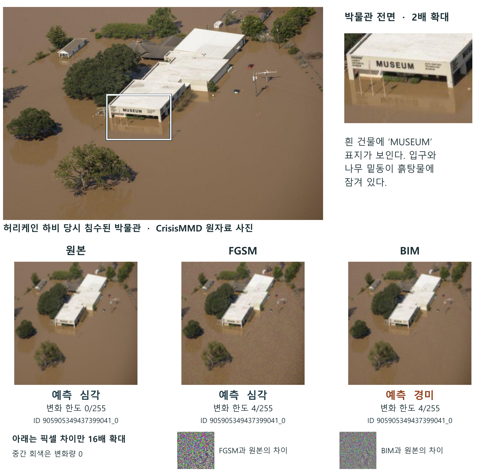
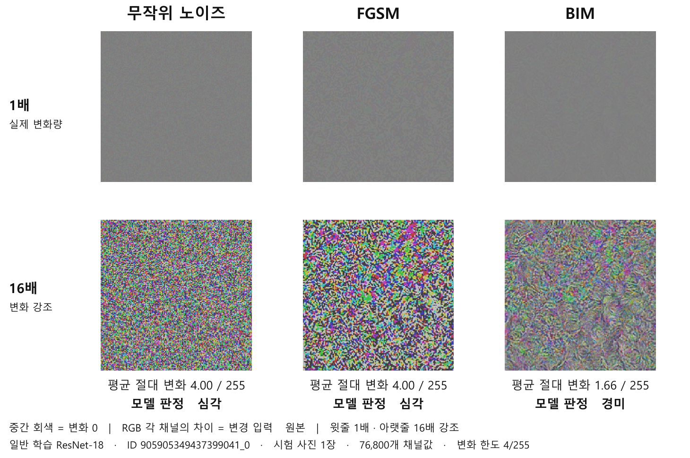
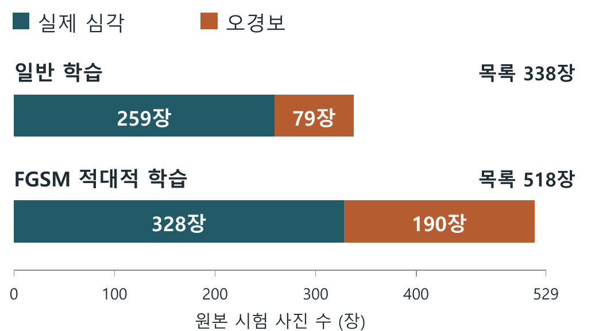

# CrisisMMD 재난 사진에서 FGSM과 BIM의 비교

재난 사진의 피해 등급이 같은 최대 변화량에서 얼마나 낮아지는지, FGSM 적대적 학습으로 심각한 피해를 더 찾으면 담당자가 확인할 오경보도 얼마나 늘어나는지 조사했다. CrisisMMD의 피해 등급이 있는 사진 3,526장에서 출발했고, 시험 사진 529장은 끝까지 고정했다.

**[최종 보고서 PDF (11쪽)](docs/final-report.pdf) · [편집용 Word](docs/final-report.docx) · [실행 결과가 담긴 노트북 (.ipynb)](notebooks/colab-validation.ipynb) · [Google Colab에서 열기](https://colab.research.google.com/github/rhcp030418/CrisisMMD_FGSM_BIM/blob/main/notebooks/colab-validation.ipynb)**

보고서 11쪽은 Colab에서 다시 확인한 결과다. 세 모델이 원본 사진 529장에 내린 판정 1,587건이 기존 기록과 일치했다. 노트북에는 침수 박물관 사진의 원본·FGSM·BIM 입력별 ‘심각’ 점수(91.6%·43.2%·0.4%)도 저장되어 있다. 259장 전체의 등급 변화는 기존 예측을 재집계했다. [세 모델의 실행 화면](figures/colab-models.jpg) · [박물관 사진의 실행 화면](figures/colab-museum.jpg)

| 찾는 자료 | 바로가기 |
|---|---|
| 가중치와 원 실험 자료 | [v1.0.1 실험 ZIP](https://github.com/rhcp030418/CrisisMMD_FGSM_BIM/releases/download/v1.0.1/CrisisMMD-full-submission.zip)에는 모델 가중치와 당시의 10쪽 보고서가 들어 있다. Colab 부록을 포함한 최종본과 노트북은 위 링크에서 열 수 있다. |
| 제안서와 보고서의 발전 과정 | [최초 제안서](docs/archive/01-proposal.docx) · [공격 비교](docs/archive/02-attack-comparison.docx) · [방어 학습 추가](docs/archive/03-defense-training.docx) · [사진·그래프 추가](docs/archive/04-visual-analysis.docx) · [오경보 분석](docs/archive/05-review-workload.docx) · [침수 사례 반영](docs/archive/06-flood-case.docx) |
| 코드와 재현 절차 | [데이터 준비](prepare.py) · [일반 모델 학습 및 평가](experiment.py) · [두 방어 모델 학습](train_defense.py) · [원 실험 안내](실행안내.md) · [방어 학습 안내](방어학습_실행안내.md) |
| 사진별 정답과 예측 | [일반 학습](results/predictions.csv) · [노이즈 학습](defense/noise/predictions.csv) · [FGSM 학습](defense/fgsm/predictions.csv) · [세 모델의 동일 사진 비교](comparison/paired_predictions.csv) |
| 조건별 지표와 비용 | [세 모델의 39개 평가 조합](comparison/metrics.csv) · [같은 PC의 처리 시간 재측정](comparison/timing_comparison.csv) · [원본 심각 표시 목록의 구성](comparison/clean_alerts.csv) |

## 1. 데이터 선정과 분할 검증

CrisisMMD의 이미지 단독 피해 심각도 분류를 사용했다. 등급은 **피해 거의 없음, 경미, 심각**이다. 공식 학습·시험 분할에서 트윗 ID 62개와 원본 파일 해시 10개가 겹쳤다. 같은 게시물 ID·파일 해시·전처리 픽셀 해시로 연결된 행을 묶고 시험, 검증, 학습 순으로 우선권을 주었다. [고정된 데이터 리비전](https://huggingface.co/datasets/QCRI/CrisisMMD/tree/10a5626ba112ab9c50369c473a2062bcf205d708) · [이미지별 분할 명세](split_manifest.json) · [분할 검증 결과](results/audit.json)

| 분할 | 공식 사진 수 | 실제 사용 | 피해 거의 없음 / 경미 / 심각 |
|---|---:|---:|---:|
| 학습 | 2,468 | 2,261 | 311 / 529 / 1,421 |
| 검증 | 529 | 508 | 67 / 122 / 319 |
| 시험 | 529 | 529 | 71 / 126 / 332 |

## 2. FGSM과 BIM이 같은 사진에서 바꾼 판정

일반 학습 ResNet-18이 원본에서 심각을 맞힌 **259장**을 비교했다. 최대 픽셀 변화량은 모두 4/255다. 장당 시간은 RTX 5070 Ti에서 **시험 529장 전체**를 배치 처리한 재실험 값이다. 각 조건을 세 번 측정하고 중앙값을 기록했다. [첫 실험 조건표](results/conditions.csv) · [재실험 조건표](reproduction/conditions.csv) · [재실험 사진별 예측](reproduction/predictions.csv) · [짝지은 검산 결과](reproduction/audit.json)

| 시험 입력 | 심각에서 하락 | 하락률 | ‘피해 거의 없음’까지 하락 | 재측정 시간 |
|---|---:|---:|---:|---:|
| 무작위 노이즈 | 5장 | 1.9% | 2장 | 0.117 ms/장 |
| FGSM | 235장 | 90.7% | 101장 | 0.389 ms/장 |
| BIM | 259장 | 100.0% | 106장 | 1.403 ms/장 |

같은 사진끼리 대조하면 **BIM에서만 24장이 추가로 하락했고 장당 처리 시간은 3.6배**였다. 최저 등급 판정의 순증가는 5장이었다. 새로 최저 등급이 된 19장과 그 등급을 벗어난 14장이 모두 있었기 때문이다. 변화 한도 4종과 입력 변경 방식 3종을 같은 PC에서 다시 평가하자 529장의 개별 예측이 12개 조건 모두에서 첫 실험과 일치했다. [한도별 하락률 그래프](figures/01_변화한도별_등급하락률.png) · [첫 측정과 재측정의 차이](comparison/timing_comparison.csv)

### 실제 사례 — 허리케인 하비로 침수된 박물관

흰 지붕 건물의 전면에 ‘MUSEUM’이라고 적혀 있고 입구는 물에 잠겨 있다. 일반 학습 모델은 원본과 FGSM 입력을 **심각**, BIM 입력을 **경미**로 분류했다. 이미지 ID는 `905905349437399041_0`이다. [원자료 사진](figures/02_침수박물관_원자료.jpg) · [실제 예측 등급](figures/figure_labels.json) · [사진 출처와 확대 배율](figures/출처와_판독법.txt)

### 사진에 들어간 노이즈만 보기

같은 박물관 사진의 **변경 입력에서 원본을 빼서** RGB 채널별 변화만 남겼다. 무작위 노이즈는 각 채널에 양수 또는 음수 방향을 무작위로 골라 더했다. FGSM은 정답 분류 손실이 커지는 방향으로 한 번 움직였다. BIM은 같은 변화 한도 안에서 방향을 매번 다시 구해 다섯 번 움직였다. 세 조건 모두 채널값을 0~1 범위로 제한했다.

**중간 회색은 변화 0**이다. 표시 색은 각 RGB 채널에서 `0.5 + 배율 × (변경 입력 − 원본)`으로 계산하고 0~1 범위로 제한했다. 16배는 그림에만 적용했다. 일반 모델이 본 입력의 최대 절대 변화는 세 경우 모두 4/255였다. 이 사진의 채널 76,800개에서 평균 절대 변화는 각각 4.00/255, 4.00/255, 1.66/255였다. 원본·무작위·FGSM의 예측은 심각, BIM의 예측은 경미였다. [정확한 수치 CSV](comparison/museum_noise.csv) · [원본 및 세 변경 입력 배열](comparison/museum_inputs.npz)

| 개별 노이즈 PNG (160×160) | 실제 변화량 | 변화량 16배 강조 |
|---|---|---|
| 무작위 | [1배](figures/noise/sign_noise-1x.png) | [16배](figures/noise/sign_noise-16x.png) |
| FGSM | [1배](figures/noise/fgsm-1x.png) | [16배](figures/noise/fgsm-16x.png) |
| BIM | [1배](figures/noise/bim-1x.png) | [16배](figures/noise/bim-16x.png) |

## 3. 방어 학습의 효과와 원본에서 늘어난 오경보

강의의 적대적 학습 실습을 참고해 같은 초기화와 데이터 분할로 노이즈 학습 및 FGSM 적대적 학습 모델을 각각 10에폭 훈련했다. 원본 검증 macro-F1이 가장 높았던 에폭은 일반·노이즈 모델이 1, FGSM 모델이 3이었다. [일반 모델 학습 기록](results/training.json) · [노이즈 모델 기록](defense/noise/training.json) · [FGSM 모델 기록](defense/fgsm/training.json) · [검증 성능과 체크포인트 선택](comparison/training_summary.json)

**실제 심각 사진 332장 중 맞힌 수**를 같은 한도 4/255에서 비교했다. 세 모델이 원본에서 모두 맞힌 248장만 별도로 비교한 결과도 제공한다. [전체 시험 지표와 공통 정답 집단](comparison/metrics.csv) · [심각 재현율 그래프](figures/03_학습방식별_심각재현율.png)

| 학습 방식 | 원본 | FGSM 입력 | BIM 입력 | 원본 macro-F1 (시험 529장) |
|---|---:|---:|---:|---:|
| 일반 학습 | 259장 (78.0%) | 24장 (7.2%) | 0장 (0.0%) | 0.490 |
| 노이즈 학습 | 263장 (79.2%) | 15장 (4.5%) | 0장 (0.0%) | 0.475 |
| FGSM 적대적 학습 | 328장 (98.8%) | 290장 (87.3%) | 60장 (18.1%) | 0.305 |

**원본 529장의 검토 목록**에서 오경보는 실제 등급이 경미하거나 피해가 거의 없는데 모델이 심각으로 표시한 사진이다. 일반 모델의 목록에는 실제 심각 259장과 오경보 79장, FGSM 학습 모델의 목록에는 실제 심각 328장과 오경보 190장이 들어갔다. 심각 사진을 **69장 더 발견하면서 오경보도 111장 늘었고**, 검토 목록의 정밀도는 **76.6%에서 63.3%**로 낮아졌다. [오경보·누락 건수 CSV](comparison/clean_alerts.csv)

## 4. 결과 검산과 재실행

1. **저장된 예측만 다시 집계할 때**는 저장소 루트에서 `python compare_defenses.py`를 실행한다. Python 표준 라이브러리로 세 모델의 동일 이미지 ID와 개별 판정을 대조한다. [집계 코드](compare_defenses.py) · [결과 CSV](comparison/metrics.csv)
2. **원 실험을 검산하거나 같은 가중치로 GPU 평가를 재현할 때**는 [전체 제출 ZIP](https://github.com/rhcp030418/CrisisMMD_FGSM_BIM/releases/download/v1.0.1/CrisisMMD-full-submission.zip)을 압축 해제한다. 일반 모델과 두 방어 모델의 가중치, 원본 예측과 보고서가 함께 들어 있다. `python verify.py`로 일반 모델의 결과를 검산할 수 있다. [검산 코드](verify.py)
3. **데이터를 준비하고 평가할 때**는 [실행 안내](실행안내.md)의 환경에서 `python prepare.py`를 실행한 뒤 `python experiment.py --reuse-model`을 실행한다. 방어 모델 평가와 처음부터 학습하는 명령은 [방어 학습 실행 안내](방어학습_실행안내.md)에 있다. 재평가 결과는 실행 폴더의 기존 결과 파일에 기록되므로 비교용 원본은 별도 사본으로 보관한다.

실측 환경은 Windows, Python 3.14.10, PyTorch 2.11.0+cu128, torchvision 0.26.0+cu128, RTX 5070 Ti였다. 시드는 20261123이다. 같은 체크포인트로 얻은 재현성, 서로 다른 재난·모델·학습 시드에서의 일반화는 별개다. [일반 모델 환경·혼동행렬](results/summary.json) · [재실험 환경](reproduction/summary.json) · [데이터 준비 패키지 버전](requirements-data.txt)

## 데이터와 참고문헌

- CrisisMMD 데이터와 예시 사진에는 배포본의 CC BY-NC-SA 4.0 이용 조건이 적용된다. 시험 원본 전체는 지정된 공개 리비전에서 준비한다. [QCRI 데이터](https://huggingface.co/datasets/QCRI/CrisisMMD) · [배포본 이용 조건](CrisisMMD_LICENSE.txt) · [CrisisMMD 원 논문](https://arxiv.org/abs/1805.00713)
- FGSM의 단일 갱신과 BIM의 반복 갱신에 관한 원 논문. [Goodfellow 외, FGSM](https://arxiv.org/abs/1412.6572) · [Kurakin 외, BIM §2.2](https://arxiv.org/pdf/1607.02533)
- 단일 단계 방식으로 학습한 모델을 여러 조건에서 평가한 연구. [Kurakin 외, Adversarial Machine Learning at Scale](https://arxiv.org/abs/1611.01236)
